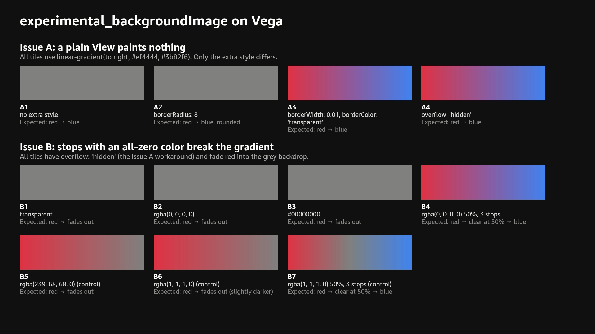
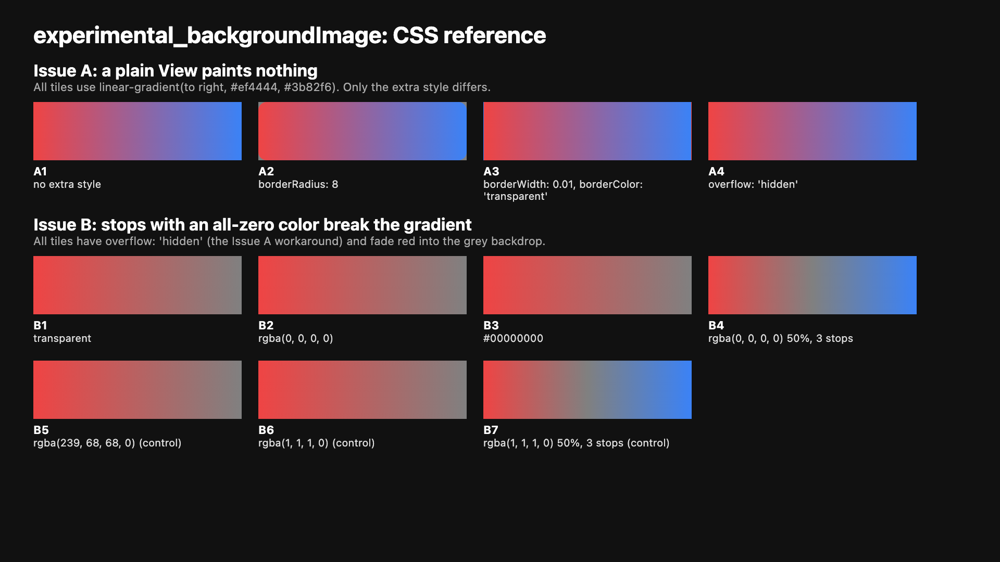

# Vega gradient repro

Minimal React Native for Vega app that reproduces two rendering bugs in RN 0.83's
`experimental_backgroundImage` (CSS-style linear/radial gradients) on Vega.

| Issue | Summary |
| ----- | ------- |
| **A** | A plain `View` paints nothing. The gradient only draws when the View also has a border or clip path (`overflow: 'hidden'`, or `borderWidth: 0.01, borderColor: 'transparent'`). `borderRadius` alone doesn't help. |
| **B** | Any stop whose color is all zeros (`transparent`, `rgba(0, 0, 0, 0)`, `#00000000`) breaks the gradient. With 2 stops nothing is painted; with 3+ stops that stop is lost. A transparent color with non-zero RGB (`rgba(1, 1, 1, 0)`) works. |

Every case is a 200×56 dp tile on a neutral grey backdrop, so "nothing painted"
shows up as plain grey. The cases are defined in [`src/cases.ts`](src/cases.ts).

## Results

| Vega device | CSS reference (Chrome) |
| ----------- | ---------------------- |
|  |  |

| Case | Style | CSS | Vega |
| ---- | ----- | --- | ---- |
| A1 | no extra style | red → blue | ❌ nothing painted |
| A2 | `borderRadius: 8` | red → blue, rounded | ❌ nothing painted |
| A3 | `borderWidth: 0.01, borderColor: 'transparent'` | red → blue | ✅ |
| A4 | `overflow: 'hidden'` | red → blue | ✅ |
| B1 | `#ef4444 → transparent` | fades out | ❌ nothing painted |
| B2 | `#ef4444 → rgba(0, 0, 0, 0)` | fades out | ❌ nothing painted |
| B3 | `#ef4444 → #00000000` | fades out | ❌ nothing painted |
| B4 | `#ef4444, rgba(0, 0, 0, 0) 50%, #3b82f6` | red → clear → blue | ❌ middle stop lost (plain red → blue) |
| B5 | `#ef4444 → rgba(239, 68, 68, 0)` | fades out | ✅ |
| B6 | `#ef4444 → rgba(1, 1, 1, 0)` | fades out | ✅ |
| B7 | `#ef4444, rgba(1, 1, 1, 0) 50%, #3b82f6` | red → clear → blue | ✅ |

All B cases have `overflow: 'hidden'`, so Issue A doesn't hide them.

## Environment

- Vega SDK 2.0.13986, Vega CLI 1.4.9
- `@amazon-devices/react-native-kepler` 4.0.2 (RN 0.83.0), `@amazon-devices/kepler-cli-platform` 0.22.14
- Fire TV device, armv7, release build, app in foreground
- `/etc/os-release`:

  ```
  NAME="OS"
  OE_VERSION="4.0.0"
  OS_MAJOR_VERSION="2"
  OS_MINOR_VERSION="0"
  RELEASE_ID="25"
  OS_VERSION="2.0"
  BRANCH_CODE="TV Ship"
  BUILD_DESC="OS 2.0 (TV Ship/85)"
  BUILD_FINGERPRINT="4.0.221715.0(5cf44be4fdaf0f84)/85N:user/release-keys"
  BUILD_VARIANT="user"
  BUILD_TAGS="release-keys"
  BUILD_DATE="Wed Nov 11 20:18:04 UTC 2026"
  BUILD_TIMESTAMP="1794428284"
  VERSION_NUMBER="2502000008520"
  ```

## Run it

```sh
npm install
npm run build:release

vega device list                     # note the device serial
vega device install-app -p build/armv7-release/vega-gradient-repro_armv7.vpkg -d <serial>
vega device launch-app -a com.example.vegagradientrepro.main -d <serial>
```

Use `build/aarch64-release/…` or `build/x86_64-release/…` (Simulator) for other targets.

Screenshot:

```sh
vega exec vda shell "gwsi-tool-screenshooter2 /tmp/repro.png"
vega exec vda pull /tmp/repro.png docs/device.png
```

CSS reference: open [`reference.html`](reference.html) in Chrome. Tile sizes are in
CSS px (= dp), so it lines up with the device screenshot. To regenerate the image:

```sh
"/Applications/Google Chrome.app/Contents/MacOS/Google Chrome" --headless=new \
  --hide-scrollbars --window-size=960,540 --force-device-scale-factor=2 \
  --screenshot="$PWD/docs/css-reference.png" "file://$PWD/reference.html"
```

## Suspected causes

**Issue A.** The JS side is fine: `processBackgroundImage` is registered in the View
config, so the parsed gradient reaches native code. The native renderer seems to draw
the background image only inside the border/clip drawing path, which runs only when the
View has a non-zero border or `overflow: 'hidden'`.

**Issue B.** `transparent`, `rgba(0, 0, 0, 0)` and `#00000000` all go through
`processColor()` to `0x00000000`, the number `0`. The JS parser accepts it (it checks
`== null`), but native code seems to treat color `0` as "no color", i.e. a color hint
without a color. A 2-stop gradient is then invalid and dropped; with 3+ stops the zero
stop is ignored.

## Workarounds

- Issue A: add `overflow: 'hidden'` to every View that uses `experimental_backgroundImage`.
- Issue B: replace all-zero stops with a transparent color that has non-zero RGB.
  Reuse the neighbouring stop's RGB to mimic CSS's premultiplied interpolation
  (e.g. `rgba(239, 68, 68, 0)`); for black, `rgba(1, 1, 1, 0)` looks the same.
